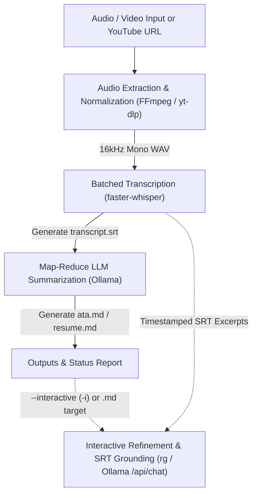

# Clerk - Local Meeting & Audio Pipeline

A high-performance, privacy-focused Python CLI application that processes audio or video files (and YouTube URLs), transcribes them using `faster-whisper`, generates structured Portuguese meeting minutes (`Ata`) or video summaries using local LLMs via Ollama, and provides an interactive TUI session to refine the `Ata` with `.srt` transcript grounding.

---

## 🏗️ Pipeline Architecture



1. **Audio Extraction**: Converts input files (`.mp3`, `.mp4`, `.wav`, `.mkv`) or YouTube URLs into normalized PCM 16-bit, 16kHz mono `.wav` audio via `ffmpeg` / `yt-dlp`.
2. **Batched Transcription**: Transcribes audio in parallel batches using `faster-whisper` (`BatchedInferencePipeline`) and outputs a timestamped `.srt` subtitle file.
3. **Structured Summarization**: Feeds the transcript to a local **Ollama** model (`LiquidAI/lfm2.5-1.2b-instruct`, `gemma4:e2b`, or custom) to produce structured Portuguese meeting minutes / Ata (*Contexto*, *Pauta e discussões*, *Decisões*, *Encaminhamentos*, *Pendências*). Long transcripts are automatically split and consolidated using Map-Reduce.
4. **Interactive Ata Refinement (`v3.0`)**: Optionally opens an interactive session (`-i` / `--interactive` or passing an existing `*_ata.md` directly) where you can supply participant names, assign action-item owners, add meeting context that speech-to-text lacks, and search the `.srt` via `rg`/`grep` with `[HH:MM:SS]` citations.

---

## 💻 Local CLI Execution

### Prerequisites

* **Python >= 3.14**
* **[uv](https://docs.astral.sh/uv/)** package manager
* **FFmpeg** (`apt install ffmpeg` or `brew install ffmpeg`)
* **ripgrep (`rg`)** *(optional, recommended for fast `.srt` grounding in interactive mode; falls back to `grep` or Python `re`)*
* **[Ollama](https://ollama.com/)** running locally: `ollama pull LiquidAI/lfm2.5-1.2b-instruct`

### Installation & Usage

```bash
# Install dependencies (CPU default)
uv sync

# Or install with NVIDIA CUDA runtime libraries for GPU mode
uv sync --extra cuda

# Run pipeline
uv run clerk <path_or_youtube_url> [OPTIONS]
```

### Configuration Profiles & Presets

| Shortcut | Preset (`-p`) | Whisper Model | Device | Compute Type | Default LLM |
| :--- | :--- | :--- | :--- | :--- | :--- |
| *(Default)* | `cpu` | `large-v3-turbo` | `cpu` | `int8` | `LiquidAI/lfm2.5-1.2b-instruct` |
| `--fast` | `fast` | `small` | `cpu` | `int8` | `LiquidAI/lfm2.5-1.2b-instruct` |
| `--gpu` | `gpu` / `cuda` | `large-v3-turbo` | `cuda` | `float16` | `gemma4:e2b` |
| — | `accurate` | `large-v3` | `cuda` | `float16` | `gemma4:e2b` |

> 💡 *GPU presets (`gpu`, `cuda`, `accurate`) and `--gpu` flags are automatically validated and disabled when running in CPU mode.*

### Options

| Option | Type | Default | Description |
| :--- | :--- | :--- | :--- |
| `--target` | `str` | *Required* | Local file path (`.mp4`, `.mp3`, `.srt`, `.md`) or YouTube URL (also accepted as positional argument) |
| `--preset`, `-p` | `str` | `cpu` | Configuration profile (`cpu`, `fast`, `gpu`, `cuda`, `accurate`) |
| `--gpu` | `flag` | `False` | Shortcut for `--preset gpu` |
| `--fast` | `flag` | `False` | Shortcut for `--preset fast` |
| `--interactive`, `-i` | `flag` | `False` | Launch interactive Ata/summary refinement session with SRT grounding (auto-enabled if target is `.md`) |
| `--srt` | `path` | `None` | Explicit path to companion `.srt` file for interactive grounding |
| `--transcribe-only` | `flag` | `False` | Execute only audio extraction and speech transcription steps |
| `--summarize-only` | `flag` | `False` | Execute only transcript summarization step (auto-detected if target is `.srt`) |
| `--prompt` | `str` | `None` | Inline custom summary prompt template (supports `{transcript}` and `{language}`) |
| `--prompt-file` | `path` | `None` | Path to custom summary prompt template file |
| `--consolidation-prompt` | `str` | `None` | Inline custom consolidation prompt template (supports `{category}`, `{items}`, `{language}`) |
| `--consolidation-prompt-file` | `path` | `None` | Path to custom consolidation prompt template file |
| `--whisper-batch-size` | `int` | `2` | Transcription batch size (Default: `2` on CPU, `4` on GPU) |
| `--whisper-model` | `str` | *(preset)* | Whisper model size (`tiny`, `small`, `medium`, `large-v3`, `large-v3-turbo`) |
| `--whisper-device` | `str` | *(preset)* | Compute device (`cpu` or `cuda`) |
| `--whisper-compute-type` | `str` | *(preset)* | Quantization (`int8`, `float16`, `float32`, `default`) |
| `--llm-model` | `str` | *(preset)* | Ollama model name |
| `--resume`, `-r` | `flag` | `False` | Reuse existing intermediate files (`.wav` / `.srt` / summary) |
| `--force`, `-f` | `flag` | `False` | Force re-generation of all pipeline steps from scratch |
| `--video` | `flag` | `False` | Enforce video summary prompt template (saves summary to `<stem>_resume.md`) |
| `--meeting` | `flag` | `False` | Enforce meeting minutes (Ata) prompt template (saves summary to `<stem>_ata.md`) |
| `--verbose` | `flag` | `False` | Enable detailed configuration and step timing logs |

---

## 💬 Interactive Ata Refinement (`v3.0`)

Because `faster-whisper` transcribes speech without speaker diarization or external project context, you can enter an interactive session to refine the generated `Ata`—adding participant names, attributing decisions/action items, or querying the `.srt` transcript for exact quotes and timestamps:

```bash
# 1. Run full pipeline and enter interactive refinement right after
uv run clerk meeting.mp4 -i

# 2. Or open an existing Ata directly (auto-discovers companion meeting_transcript.srt)
uv run clerk output/meeting_ata.md
```

### Interactive Slash Commands & Workflow

- **Natural Refinement**: Type instructions like *"Participants were Gabriel (Tech Lead) and Mônica (PM). Attribute the database migration in Encaminhamentos to Gabriel."*
- **Diff & Confirmation**: Proposed edits preserve untouched `##` sections intact, display a colorized unified diff (`+` / `-`), and prompt you to **Accept & save**, **Discard**, or **Ask model to adjust further**.
- **`/search <query>`**: Instant `rg` / `grep` search over the `.srt` file displaying timestamped `[HH:MM:SS -> HH:MM:SS]` subtitle windows without waiting for the LLM.
- **`/show`**: Render the current `Ata` Markdown in the terminal.
- **`/diff`**: Inspect all changes made since the start of the interactive session.
- **`/undo`**: Revert the last accepted edit both in memory and on disk.
- **`/help`** / **`/exit`**: View command help or exit and unload the Ollama model from memory.

---

### ⚡ Isolated Step Execution

You can run individual stages of the pipeline independently without re-executing the entire workflow:

- **Transcribe Only**:
  ```bash
  uv run clerk audio.mp3 --transcribe-only
  ```
- **Summarize Only** (Target `.srt` transcript or existing audio/video with `.srt` present):
  ```bash
  uv run clerk output/sample_transcript.srt
  ```

### 🎨 Custom Prompt Overrides

Override default prompts for stage 1 (summary/chunk) or stage 2 (item consolidation):

```bash
# Custom summary prompt file
uv run clerk video.mp4 --prompt-file my_summary_prompt.txt

# Dual prompt overrides
uv run clerk meeting.mp3 \
  --prompt-file prompts/chunk_summary.txt \
  --consolidation-prompt-file prompts/merge_items.txt
```

---

## 📁 Output Artifacts

All outputs are suffixed with the input file/video name and saved to `--output-dir` (default: `output/`):

- **`<name>_transcript.srt`**: Timestamps and subtitles in SubRip format.
- **`<name>_resume.md`**: Video summary (used when `--video` is set or processing video URLs).
- **`<name>_ata.md`**: Meeting minutes / Ata summary (used when `--meeting` is set or processing local audio/meeting files).
- **`<name>_metadata.json`**: Execution timings, models used, and audio metrics.
- **`<name>_normalized.wav`**: 16kHz mono audio extracted from input.

---

## 🛠️ Verification & Testing

```bash
# Run unit tests (>=85% coverage gate)
uv run clerk-test

# Type checking (Pyrefly)
uv run pyrefly check

# Code linting (Ruff)
uv run ruff check
```
