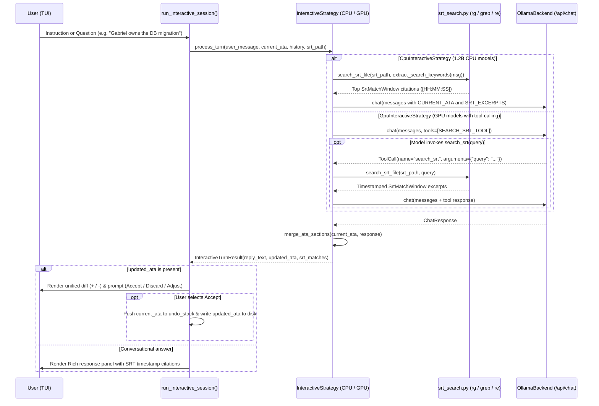

# Modules: `src/clerk/interactive.py` & `src/clerk/srt_search.py`

The `interactive` and `srt_search` modules power **Clerk v3.0's interactive Ata refinement loop**. Because speech-to-text (`faster-whisper`) does not perform speaker diarization or know external project context, users can enter an interactive session (`-i` / `--interactive` or passing an existing `*_ata.md` target) to supply participant names, assign action-item owners, query the `.srt` transcript for exact timestamped evidence, and refine sections safely.

---

## 🎯 Architectural Overview

---

## 🔍 SRT Search Engine (`src/clerk/srt_search.py`)

An `.srt` file stores sequence numbers, timestamps (`00:05:12,000 --> 00:05:18,400`), and spoken text on separate lines. `srt_search.py` combines line-oriented regex search tools with structured subtitle block windowing:

1. **Line-Number Lookup (`find_matching_lines`)**:
   - **Primary**: Runs `rg -n -i --no-heading` (ripgrep) when `rg` is available on `PATH`.
   - **Fallback 1**: Uses `grep -n -i -E` when `rg` is not installed.
   - **Fallback 2**: Falls back to pure Python `re.search` line-by-line if neither binary is available.
2. **Block Windowing (`search_srt_file`)**:
   - Maps matched 1-based line numbers back to parsed `SrtBlock` objects (`index`, `start_time`, `end_time`, `start_line`, `end_line`, `text`).
   - Expands each hit by `±window` (default `±1` neighboring subtitle block) and merges overlapping ranges into `SrtMatchWindow` instances so sentences split across consecutive subtitles remain unbroken.

---

## 🧠 CPU vs. GPU Interactive Strategy Pattern

Just like summarization prompts, interactive mode adapts to the capabilities of the underlying model:

| Strategy | Target Models | Mechanism |
|---|---|---|
| **`CpuInteractiveStrategy`** | `LiquidAI/lfm2.5-1.2b-instruct` & small CPU models | Avoids fragile JSON tool-calling schemas. Extracts entity/topic keywords in Python (`extract_search_keywords`), runs `search_srt_file()` upfront, and injects the top timestamped excerpts directly into a compact prompt. |
| **`GpuInteractiveStrategy`** | `gemma4:e2b`, `llama3.1:8b`, `qwen`, etc. | Uses Ollama `/api/chat` with `SEARCH_SRT_TOOL` so the model can autonomously issue additional `search_srt` queries. Automatically falls back to `CpuInteractiveStrategy` if the selected Ollama model returns HTTP 400 (`ToolNotSupportedError`). |

---

## 🛡️ Section-Safe Merging & Undo Stack

- **`merge_ata_sections(current_ata, llm_output, is_video)`**: When the model outputs one or more modified `## <Section>` blocks (e.g. updating only `## Contexto` and `## Encaminhamentos`), only those sections are patched into `current_ata`. All untouched sections remain 100% unchanged, preventing small models from accidentally dropping bullets in other sections.
- **Immediate Persistence & `/undo`**: Accepting a proposed diff immediately writes the updated Markdown to `<stem>_ata.md` on disk and pushes the prior state onto an in-memory `undo_stack`. Running `/undo` restores the previous state both in memory and on disk.

---

## 📖 Public API Reference

| Symbol | Module | Description |
|---|---|---|
| `SrtBlock` | `clerk.srt_search` | Immutable dataclass representing a single SRT subtitle block and its line span. |
| `SrtMatchWindow` | `clerk.srt_search` | Contiguous window of matched SRT blocks with `format_citation()`. |
| `parse_srt_blocks(srt_content)` | `clerk.srt_search` | Parses raw SRT text into `list[SrtBlock]`. |
| `search_srt_file(srt_path, query)` | `clerk.srt_search` | Searches `.srt` via `rg`/`grep`/Python and returns ranked `list[SrtMatchWindow]`. |
| `merge_ata_sections(current_ata, llm_output, is_video)` | `clerk.interactive` | Patches modified `##` sections into `current_ata` while preserving untouched sections. |
| `resolve_companion_srt(summary_path, explicit_srt)` | `clerk.interactive` | Resolves companion `.srt` from `--srt`, `<stem>_metadata.json`, or `<stem>_transcript.srt`. |
| `run_interactive_session(...)` | `clerk.interactive` | Main TUI loop for interactive Ata refinement and SRT search. |
